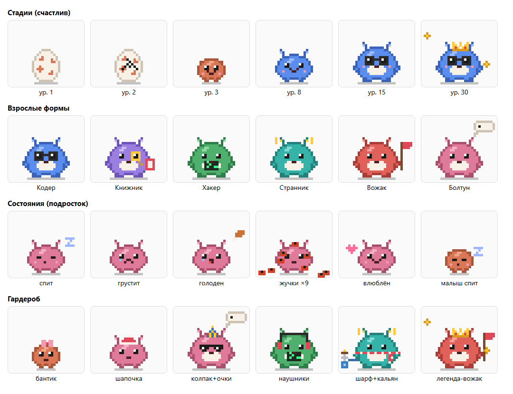

# claude-gotchi

Тамагочи для Claude Code: пиксельный питомец, который растёт, пока вы работаете с Claude.
Работает в десктопном приложении (вкладка Code) и в терминале. Нужен Claude Code 2.1.293 или новее
(API модов пока в раннем доступе).

*A Tamagotchi mod for Claude Code: a pixel pet that grows from the tokens you spend and everything you do with Claude.
It evolves into one of six adult forms, gets hungry, catches bugs from failed tool calls, and comes with daily quests,
achievements and a wardrobe shop. Russian UI.*



## Установка

В терминале Claude Code:

```bash
/plugin install tamagotchi --marketplace Smailkiller/claude-gotchi
```

Подтвердите добавление маркетплейса (`y`) и выберите область «user» — питомец появится во всех сессиях,
в том числе во вкладке Code десктопного приложения.

Разово, без установки:

```bash
git clone https://github.com/Smailkiller/claude-gotchi.git
claude --plugin-dir claude-gotchi
```

## Как он живёт

- **Опыт (XP)** — за потраченные токены (больше всего за выход модели), сообщения и вызовы инструментов.
  Уровень N → N+1 стоит `100·N^1.5` XP.
- **Стадии**: яйцо → малыш (ур. 3) → подросток (ур. 8) → взрослый (ур. 15) → легенда (ур. 30, корона).
- **Взрослая форма** зависит от того, чем вы чаще занимаетесь: правки файлов — Кодер, чтение и поиск — Книжник,
  терминал — Хакер, интернет — Странник, сабагенты — Вожак, разговоры — Болтун.
- **Потребности** убывают со временем:
  - 🍖 сытость — кормят токены каждого хода;
  - 😊 настроение — растёт от сообщений, поглаживаний и игр, падает от ошибок, прерываний и отказов в разрешении;
  - ⚡ энергия — тратится на работу, восстанавливается, пока вы отдыхаете (через 20 минут тишины питомец засыпает).
- **Бонусы к опыту**: сыт +10%, счастлив +25%, бодр +15%, серия дней подряд +5% за день (до +50%);
  голод −40%, много жучков −25%.
- **🐞 Жучки** заводятся от ошибок инструментов. Давятся кнопкой в окне или сами — когда проходят тесты
  (`pytest`, `vitest`, `npm test`, `cargo test`, …).
- **Задания дня** (три штуки, свои на каждый день), **32 достижения**, **монетки 🪙** и **магазин**:
  бантик, шапочка, колпак, наушники, корона, пиксельные очки, шарф, кальянчик.
- Мини-игра «в какой лапке токен».

## Где он виден

- Строка состояния под полем ввода: уровень, полоска опыта, потребности, жучки, монетки.
- `/pet` — окно питомца: анимированный спрайт, полоски, вкладки «Задания», «Магазин», «Достижения».
- `/pet name Пушок` — переименовать, `/pet stats` — сводка текстом.
- Всплывашки: новый уровень, эволюция, достижения, выполненные задания, голод.

Состояние общее для всех сессий и хранится в хранилище мода (`$.store`), на вашем компьютере.

## Что где

- `hooks/game.ts` — вся механика: опыт, потребности, задания, достижения, магазин.
- `hooks/sprite.ts` — пиксельные формы, наряды, анимация (SVG для десктопа, полублоки для терминала).
- `hooks/register.tsx` — события Claude Code, окно `/pet`, строка состояния.
- `hooks/pet.test.tsx` — тесты: `claude plugin test .`; проверка манифеста: `claude plugin validate .`.
